# Credline

[](https://github.com/Asmodeus8/credline/actions/workflows/ci.yml)

A digital lending platform for the Nigerian market. Borrowers apply online and get a credit decision in seconds, with the reasons spelled out. They see the full cost before accepting, link a card, and get paid. From then on the platform runs the loan: automatic card debits on each due date, retries, late fees, days-past-due buckets and write-offs. Credit officers work referrals and approvals in a console, and every action lands in an append-only audit trail.

**Spring Boot 4.2 on Java 25, PostgreSQL 18, Next.js 16.** Paystack handles card mandates, debits and payouts, with a full sandbox so the whole lifecycle runs locally.

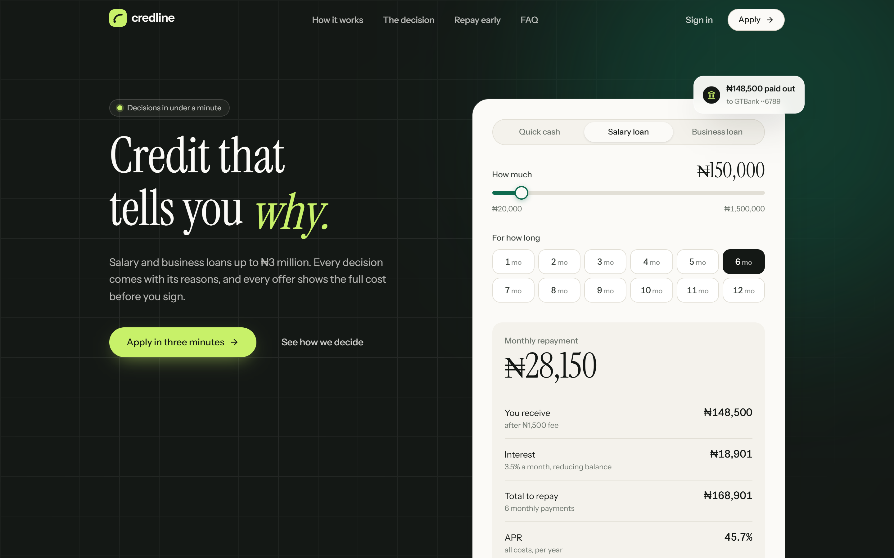

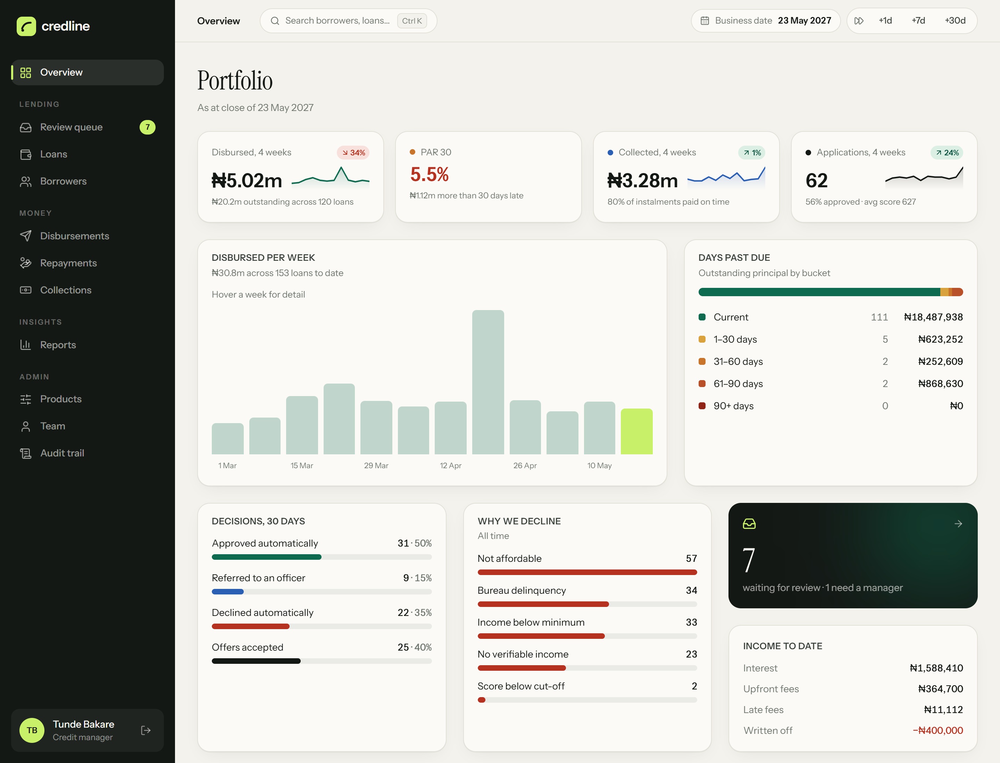

## What it does

**For borrowers**
- An animated landing page: a live calculator in the hero, and an interactive decision engine where visitors move income, debt and bureau-score sliders and watch the score, outcome and factor points change. It also has an early-repayment savings chart and a FAQ, and it respects reduced-motion settings.
- A live loan calculator: monthly repayment, fee, total cost and APR for any amount and tenor.
- A three-step application. Submitting it creates the account and runs the credit decision straight away.
- An offer page with a key facts statement and the full repayment schedule. Counter-offers say why the amount changed, and declines list every reason.
- Card linking via a ₦50 authorisation, then an immediate payout to the borrower's bank account.
- A loan page with the schedule and payments. Borrowers can pay the next instalment, everything overdue, or close the loan early and have future interest waived.

**For staff**, a console grouped into Lending, Money, Insights and Admin, with a Ctrl+K command palette that jumps to any borrower, loan or application, and CSV export on every list:
- A portfolio overview: outstanding principal, PAR 30, on-time collection rate, approval funnel, decline reasons, weekly disbursements and bucket distribution.
- A review queue showing the scorecard factor by factor, each policy rule, an affordability meter and the bureau report.
- **Maker-checker:** approvals above ₦300,000 need a manager who did not propose them. The API, the service layer and a database `CHECK` all enforce this.
- Loan files with the schedule, allocations, debit attempts, an event timeline, recorded bank transfers and write-off.
- **Borrowers:** a searchable directory with standing segments, and a borrower file with exposure, every loan and application, the latest bureau pull and a full activity timeline.
- **Disbursements and Repayments:** every payout with bank and status, and every receipt split into late fees, interest and principal, by channel.
- **Reports:** month-by-month vintage analysis (ever 30+, ever 90+, write-offs), a matrix of how loans moved between overdue buckets, collections by due week, and product performance with PAR 30.
- **Products:** pricing and limits that managers can edit, with every change audited and readable. New pricing applies only to new loans.
- **Team:** roles and separation of duties, with each person's approvals, confirmations, transfers and write-offs counted from the audit trail.
- A collections day view, plus a sandbox clock that runs end of day for every simulated day, so delinquency plays out in minutes.

| Borrower offer and key facts | Staff decision file |
|---|---|
| 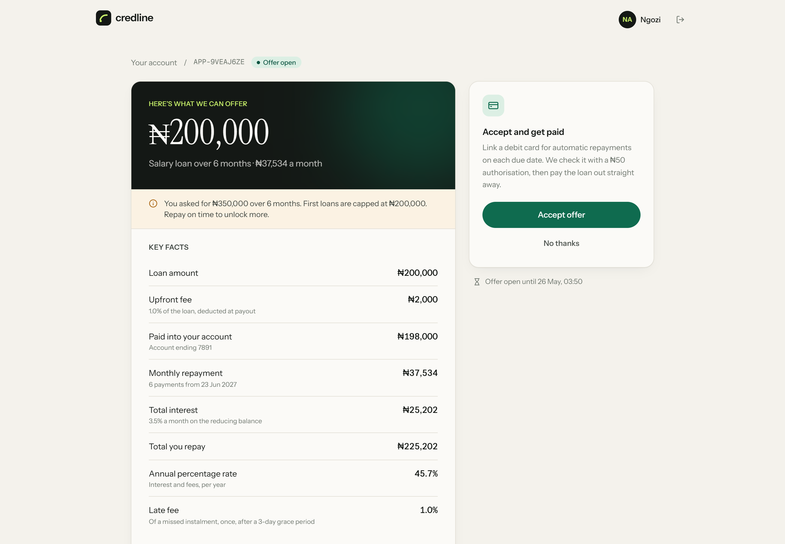 | 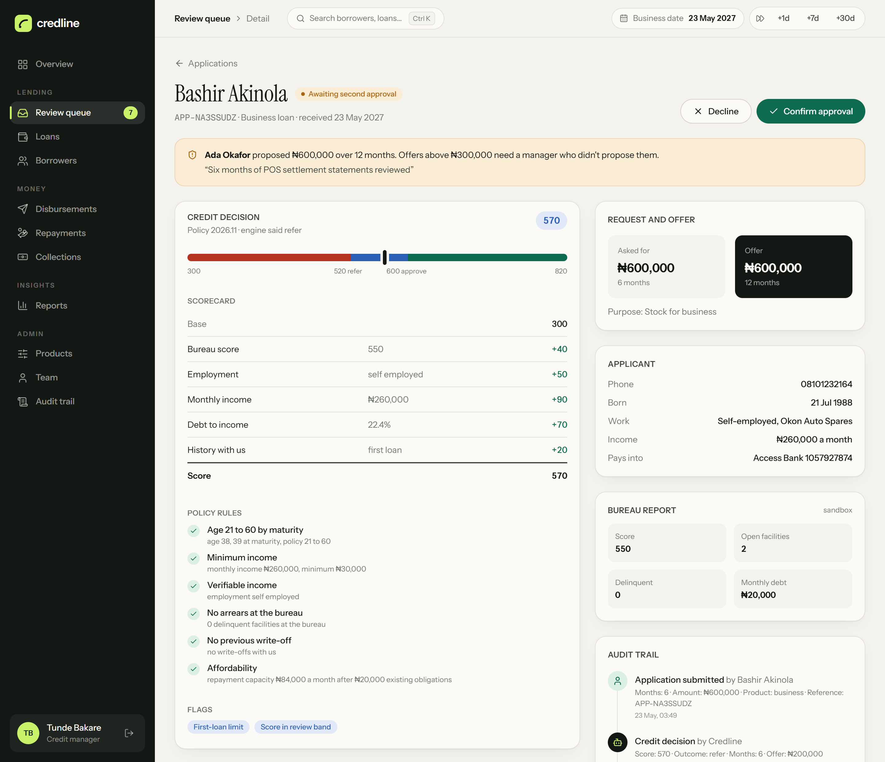 |
| 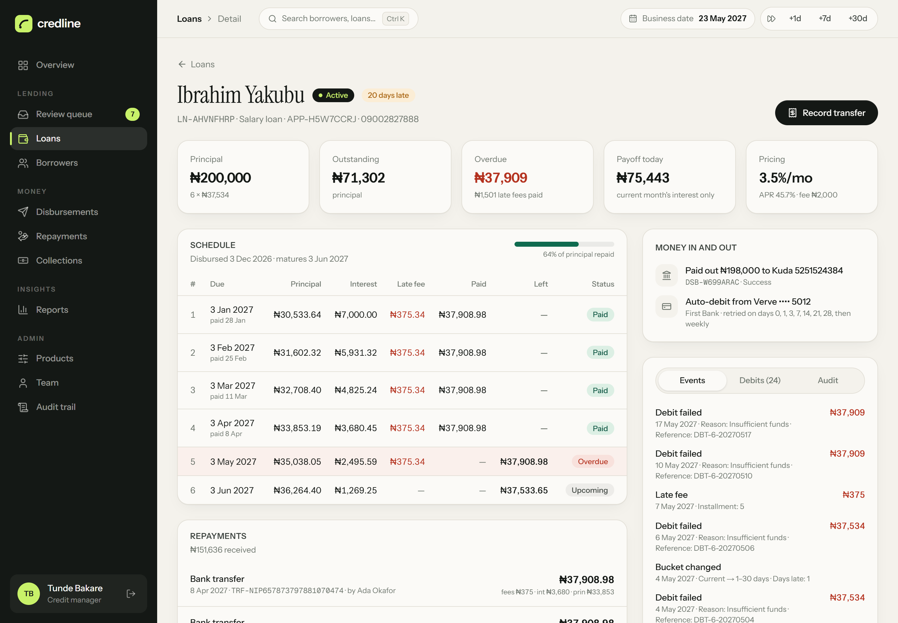 | 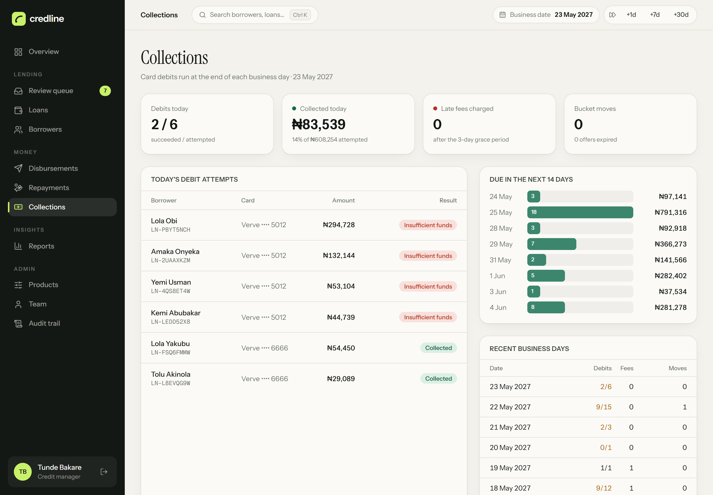 |
| 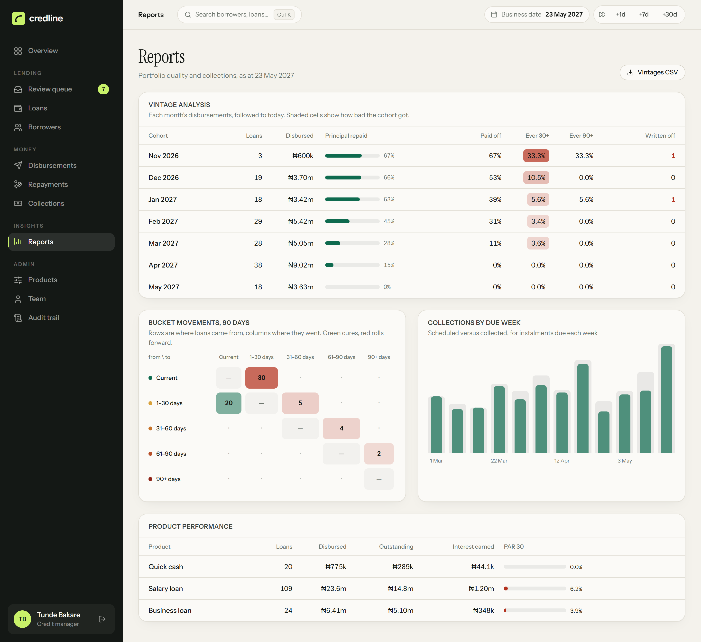 | 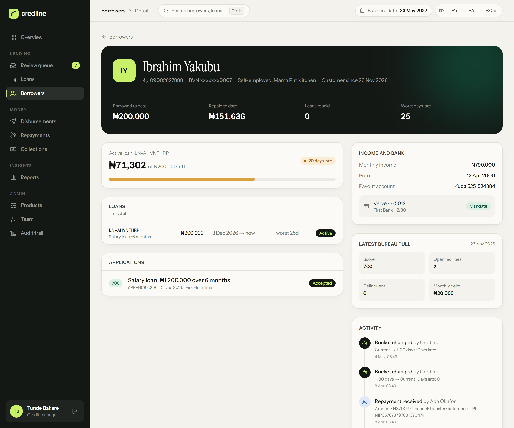 |
| 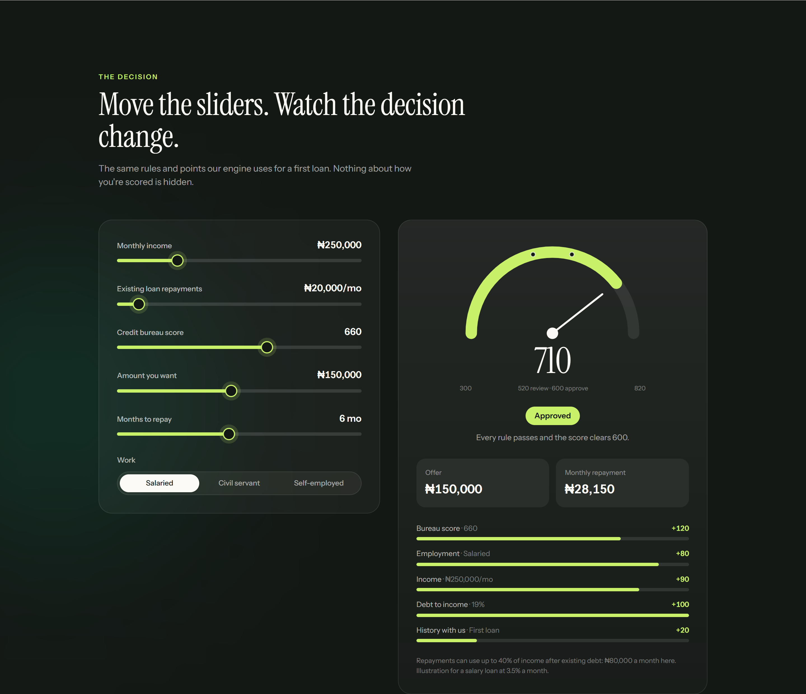 | 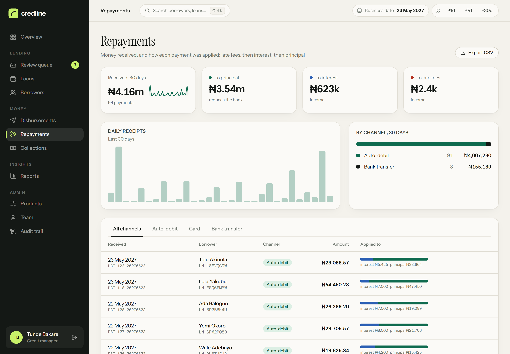 |

## The guarantees, and the tests that prove them

| Guarantee | How | Proven by |
|---|---|---|
| Money is integer kobo. Schedules always sum exactly to the principal. | `BIGINT` everywhere; `BigDecimal` with `DECIMAL128`; the last instalment absorbs rounding | `AmortizationTest` (6 parameterised cases) |
| A payment can never overpay an instalment or be lost | Loan row locked `FOR UPDATE`; DB `CHECK`s on every paid column; allocations stored per instalment | `IntegrityIT`: 24 parallel payments land exactly once each |
| Retried payments apply once | Unique repayment reference; replay returns the original receipt | `IntegrityIT`: 10 parallel retries give 1 row |
| End of day runs once per business date | Claimed row in `business_days`; unique `(loan, date)` on debit attempts | `IntegrityIT`: 6 concurrent runs give 1 debit |
| History cannot be rewritten | Triggers reject `UPDATE`/`DELETE` on decisions, repayments, allocations, loan events and audit | `IntegrityIT` |
| Four eyes on large approvals | Service check plus `CHECK (checker_id <> maker_id)` | `OriginationIT` |
| Officers cannot override affordability | Manual approvals re-checked against the applicant's repayment capacity | `OriginationIT` |
| Only managers change pricing, and every change is recorded | Role check; before and after values written to the audit trail; no-op saves write nothing | `ConsoleIT` |
| Staff screens never show a full BVN | Masked in SQL before leaving the database | `ConsoleIT` |
| Borrowers see only their own data | JWT subject scoped queries | `LoanLifecycleIT` |
| Webhooks are authentic and applied once | HMAC-SHA512 over the raw body, constant-time compare, event ids deduplicated | `PaystackWebhookTest` |

`mvn verify` runs 41 tests against a real PostgreSQL in Testcontainers, including a loan driven from application to paid-off by card debits, and a declined card falling behind through the buckets.

## Credit decisions

Policy `2026.11` is a pure function (`DecisionEngine`) over the applicant, their bureau report, their history with Credline and the product:

1. **Hard rules:** age 21 to 60 by maturity; income of at least ₦30,000; verifiable income; no arrears at the bureau; no previous write-off with us.
2. **Limits:** first loans are capped at ₦200,000, and the offer is cut to what repayments of 40% of income, after existing debt, can carry.
3. **Scorecard:** base 300, plus points for bureau score, employment, income, debt-to-income and history with us. A score of 600 or more approves, 520 to 599 goes to an officer, and below 520 declines.
4. **Referral triggers:** a thin bureau file above ₦100,000, or any offer above the ₦300,000 auto-approval limit.

Every decision stores its inputs, rule results, factor points and affordability numbers. The console shows them, and borrowers get plain-language reasons.

## Loan maths

- **Reducing balance**, equal monthly instalments: `P·r / (1 − (1+r)^−n)`. Interest is charged on the outstanding balance each month, and due dates fall on the same day each month without drifting (31 Jan → 28 Feb → 31 Mar).
- **APR** is the annualised internal rate of return of the cash the borrower actually receives (after the upfront fee) against the schedule.
- **Allocation waterfall:** oldest instalment first; within it, late fee, then interest, then principal. Any excess pays the next instalment.
- **Early payoff:** outstanding principal, plus anything overdue, plus the current month's interest. Future interest is waived and recorded per instalment.

## Collections

End of day runs for each business date (06:30 Lagos time in production, on demand in the sandbox):

1. **Card debits** for everything due. Retries happen on days 0, 1, 3, 7, 14, 21 and 28, then weekly; each attempt is unique per loan per day.
2. **Late fees**, charged once per instalment after a 3-day grace period.
3. **Days past due** recalculated, with each bucket move written to the loan's event timeline: current, 1–30, 31–60, 61–90, 90+.
4. **Expired offers** closed.

Loans more than 90 days past due can be written off, by a manager only.

## Architecture

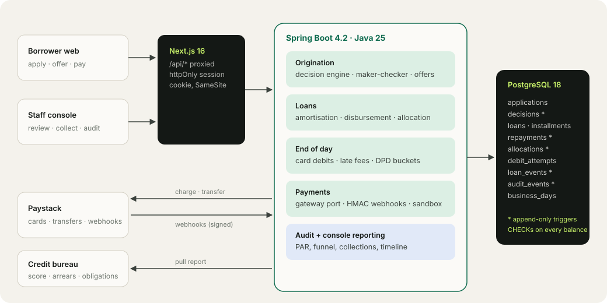

The browser only ever talks to Next.js. `/api/*` is rewritten to the Spring API, so the session is an `httpOnly`, `SameSite=Strict` cookie holding an HS256 JWT. No token ever reaches JavaScript. Payment providers sit behind a `PaymentGateway` port with Paystack and sandbox adapters, and the bureau behind a `CreditBureau` port.

## Run it

```bash
docker compose up --build        # Postgres on :5434, API on :8080, web on :3001
node scripts/seed.mjs            # about six months of lending history through the real API
```

- Borrower site: http://localhost:3001
- Staff console: http://localhost:3001/console. Demo accounts use the password `credline-demo`:
  - `ada@credline.ng` (officer)
  - `kunle@credline.ng` (officer)
  - `tunde@credline.ng` (manager)
- API docs: http://localhost:8080/api/docs

In the sandbox, the last digit of the BVN picks the bureau file: 5 to 9 is clean, 2 to 4 borderline, 1 has no record and 0 is in arrears. The test card picked at checkout decides how later debits behave: always paying, often short on the due date, or always declined.

### Production mode

| Variable | Purpose |
|---|---|
| `PAYMENTS_PROVIDER=paystack` | Switches from the sandbox to live Paystack calls |
| `PAYSTACK_SECRET_KEY` | API calls and webhook signature verification |
| `PAYSTACK_CALLBACK_URL` | Where Paystack checkout returns the borrower |
| `AUTH_SECRET` | 32+ byte session signing key |
| `SECURE_COOKIE=true` | Marks the session cookie `Secure` behind HTTPS |
| `DATABASE_URL`, `DATABASE_USER`, `DATABASE_PASSWORD` | PostgreSQL |

Point the Paystack webhook at `/api/webhooks/paystack`. Payouts and card mandates then complete asynchronously through `transfer.*` and `charge.success` events. Sandbox endpoints are not registered in this mode.

## Layout

```
api/   Spring Boot service
  credit/        decision engine, bureau port
  lending/       amortisation, allocation, delinquency (pure, unit-tested)
  origination/   applications, maker-checker, offers, card linking
  loans/         disbursement, repayments, write-offs, views
  collections/   end of day
  payments/      gateway port, Paystack, sandbox, webhook
  console/       staff API and portfolio reporting
web/   Next.js 16 borrower site and staff console
scripts/seed.mjs   synthetic portfolio, driven through the public API
```

## License

MIT
